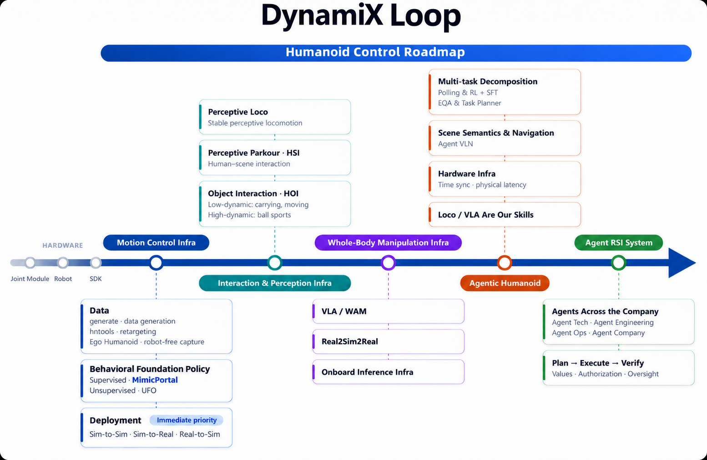

# DynamiX Loop

A humanoid control stack for Astro, from motion data and reusable policies to perception, object interaction, whole-body manipulation and agent-driven skills.

[GitHub organization](https://github.com/Dynamicx-Loop) · [RoboParty Party OS reference](https://github.com/Roboparty/Party_OS)

Motion Control Infra combines capture and generation, retargeting, behavioral foundation policies and deployment. The later branches carry over the Party OS reference structure for item-by-item review. They do not imply team implementation, dates or delivery commitments.

## Table of Contents

- [Roadmap](#roadmap)
- [Projects](#projects)
- [Datasets](#datasets)
  - [Motion control datasets](#motion-control-datasets)
  - [Manipulation datasets](#manipulation-datasets)
  - [Agent datasets](#agent-datasets)
- [Acknowledgments and References](#acknowledgments-and-references)
- [License](#license)

## Roadmap

**English** · [简体中文](assets/dynamix-loop-roadmap-zh.png)

*Working diagram adapted from [RoboParty’s Party OS](https://github.com/Roboparty/Party_OS#roadmap). RoboParty maintains its own [diagram generator](https://github.com/Roboparty/Party_OS/blob/main/scripts/build_roadmap.py); it does not generate this draft.*

**Immediate priority:** build the deployment foundation for sim-to-sim, sim-to-real and real-to-sim. The diagram shows capability progression rather than calendar dates.

## Projects

**In use** means the team uses the repository. Other third-party entries are upstream references.

| Layer | Module | Description | Repository |
|---|---|---|---|
| Know-how | Knowledge base | DynamiX Loop’s humanoid control knowledge base. | 🚧 **Under construction** |
| Motion Control Infra | Data generation · `generate` | Generate motion data for policy training. | [NVIDIA Kimodo](https://github.com/nv-tlabs/kimodo) |
| Motion Control Infra | Retargeting | **Motion Studio** is our planned primary retargeting workbench. RoboParty’s **hhtools** is the current alternative. | [DynamiX Loop Motion Studio](https://github.com/Dynamicx-Loop/motion-studio) · [RoboParty hhtools](https://github.com/Roboparty/human-humanoid-tools) |
| Motion Control Infra | Behavioral Foundation Policy · **MimicPortal** | DynamiX Loop’s motion-tracking development repository. | [Dynamicx-Loop/mimicportal](https://github.com/Dynamicx-Loop/mimicportal) · [RoboParty upstream](https://github.com/Roboparty/PartyMimic) |
| Motion Control Infra | Unsupervised learning · `UFO` | **In use.** Learn reusable humanoid behaviors with FB and TeCH. | [RoboParty/UFO](https://github.com/Roboparty/UFO) |
| Motion Control Infra | Action diffusion · `PredActor` | Upstream reference for generating motion and actions with diffusion. | [RoboParty fork](https://github.com/Roboparty/PredActor) · [MasterYip upstream](https://github.com/MasterYip/PredActor) |
| Motion Control Infra | Robot-free capture · `Ego Humanoid` | Capture human motion without a robot. | [DynamiX Loop roadmap](#roadmap) |
| Motion Control Infra | Deployment · **Immediate priority** | Transfer policies across simulators and to robots, and use hardware data to improve simulation. **Sim-to-sim · sim-to-real · real-to-sim.** | Team workstream; no repository specified |
| Interaction & Perception Infra | Interaction BFM · `I-BFM` | **In use.** Learn whole-body skills for interacting with objects. | [RoboParty/I-BFM-Code](https://github.com/Roboparty/I-BFM-Code) · [deployment example](https://github.com/Roboparty/I-BFM-Code/tree/main/deploy/g1_carry_box_166m) |
| Interaction & Perception Infra | Perceptive BFM · `P-BFM` | **In use.** Learn terrain-adaptive locomotion and motion tracking. | [RoboParty/P-BFM](https://github.com/Roboparty/P-BFM) |
| Whole-Body Manipulation Infra | JEPA world model · `INTACT-JEPA` | Upstream reference for predictive world modeling from action intent. | [RoboParty fork](https://github.com/Roboparty/INTACT-JEPA) · [ZJU upstream](https://github.com/zju3dv/INTACT-JEPA) |
| Representation Learning | Anti-collapse loss · `SADL` | Upstream reference for reducing representation collapse with Supply And Demand Loss. | [RoboParty fork](https://github.com/Roboparty/SADL) · [ZJU upstream](https://github.com/zju3dv/SADL) |

**Later branches:** Agentic Humanoid and Agent RSI System remain in the diagram for source parity. No team implementation or adoption is claimed for these branches.

## Datasets

The full Party OS catalog is retained for upstream reference. Obtain data from the original links, cite the releases and check access, licensing, and derivative-work terms before use. Availability in this table is not evidence of Astro use or permission to redistribute. Register any team-selected examples with exact source version, intended use, retargeting configuration and train/evaluation split.

### Motion control datasets

🏃 <strong>Motion control</strong>: human motion, interaction and terrain motion for tracking policies (15)

 

[hhtools retargeting modes](https://github.com/Roboparty/human-humanoid-tools/blob/main/docs/datasets.md): **mimic** for flat-ground tracking, **intermimic** for object interaction, **meshmimic** for terrain, and **R2R** for transfer between robots. A dash means team usage is not recorded here.

| Dataset | Content | hhtools mode | Paper | Download | DynamiX Loop usage |
|---|---|---|---|---|---|
| AMASS | Combined optical capture collections represented in SMPL-X. | mimic | [📄&nbsp;arXiv](https://arxiv.org/abs/1904.03278) | [🌐&nbsp;site](https://amass.is.tue.mpg.de/) | — |
| LAFAN1 | BVH capture of movement including locomotion, dance, falls and recovery. | mimic | [📄&nbsp;arXiv](https://arxiv.org/abs/2102.04942) | [💻&nbsp;GitHub](https://github.com/ubisoft/ubisoft-laforge-animation-dataset) | MimicPortal |
| BONES-SEED (SOMA) | Broad motion-capture corpus using the SOMA representation. | mimic | [📄&nbsp;arXiv](https://arxiv.org/abs/2603.16858) | [🤗&nbsp;HF](https://huggingface.co/datasets/bones-studio/seed) | MimicPortal |
| 100STYLE | Characterful walking and running recorded with Xsens, distributed as 60 Hz BVH. | mimic | [📄&nbsp;ACM](https://dl.acm.org/doi/10.1145/3522618) | [🌐&nbsp;site](https://www.ianxmason.com/100style/) | MimicPortal |
| Motion-X | Full-body motion recovered from video footage. | mimic | [📄&nbsp;NeurIPS](https://proceedings.neurips.cc/paper_files/paper/2023/file/4f8e27f6036c1d8b4a66b5b3a947dd7b-Paper-Datasets_and_Benchmarks.pdf) | [💻&nbsp;GitHub](https://github.com/IDEA-Research/Motion-X) | — |
| PHUMA | Humanoid movement data with physical grounding. | mimic | [📄&nbsp;arXiv](https://arxiv.org/abs/2510.26236) | [💻&nbsp;GitHub](https://github.com/DAVIAN-Robotics/PHUMA) | — |
| GVHMR | Tool for reconstructing human motion from a single-camera video. | mimic | [📄&nbsp;arXiv](https://arxiv.org/abs/2409.06662) | [💻&nbsp;GitHub](https://github.com/zju3dv/GVHMR) | — |
| OMOMO | Motion sequences involving people and manipulated objects. | intermimic | [📄&nbsp;arXiv](https://arxiv.org/abs/2309.16237) | [🤗&nbsp;HF](https://huggingface.co/datasets/YaojieShen/hhtools_omomo) | — |
| OmniContact | Human–object sequences recorded with optical motion capture at 90 Hz. | intermimic | [📄&nbsp;arXiv](https://arxiv.org/abs/2606.26201) | [🤗&nbsp;HF](https://huggingface.co/datasets/lightcone02/OmniContact-Dataset) | — |
| HiPHI | Optical motion capture of whole-body human motion and object interaction. | — | [Noitom Robotics](https://noitomrobotics.com/hiphi-a-large-scale-benchmark-for-high-precision-human-motion-and-object-interaction/) | [Hugging Face](https://huggingface.co/datasets/noitomrobotics/HiPHI) | — |
| holosoma | Motion and terrain references for perceptive locomotion and parkour. | meshmimic | [📄&nbsp;arXiv](https://arxiv.org/abs/2509.26633) | [💻&nbsp;GitHub](https://github.com/amazon-far/holosoma) | — |
| PARC MS | Terrain-aligned motions for obstacle traversal and parkour. | meshmimic | [📄&nbsp;arXiv](https://arxiv.org/abs/2505.04002) | [🤗&nbsp;HF](https://huggingface.co/datasets/YaojieShen/hhtools_parc_ms) | — |
| Parkour Mocap | 143 clips of obstacle movements, including vaults, slopes, beam balance and flips, with 120 Hz optical capture. | meshmimic | — | [🤗&nbsp;HF](https://huggingface.co/datasets/YaojieShen/hhtools_parkour_mocap) | — |
| MotionDecode | Unitree G1 trajectories sampled at 120 Hz. | R2R | [🌐&nbsp;site](https://chingmudata.github.io/MotionDecode/) | [🤗&nbsp;HF](https://huggingface.co/datasets/CMRobot/MotionDecode) | — |
| any4hdmi collection | A collection of datasets already converted for MimicLite training. | — | — | [🤗&nbsp;HF](https://huggingface.co/collections/elijahgalahad/any4hdmi) | — |

### Manipulation datasets

🤲 <strong>Manipulation</strong>: robot teleoperation, humanoid, egocentric human and simulation data (19)

 

| Category | Dataset | Content | Paper | Download |
|---|---|---|---|---|
| 🦾 Cross-embodiment robot | Open X-Embodiment | More than one million physical robot trajectories spanning 22 embodiments. | [📄&nbsp;arXiv](https://arxiv.org/abs/2310.08864) | [🌐&nbsp;site](https://robotics-transformer-x.github.io/) |
| | DROID | 76,000 Franka manipulation trajectories in diverse real settings. | [📄&nbsp;arXiv](https://arxiv.org/abs/2403.12945) | [🌐&nbsp;site](https://droid-dataset.github.io/) |
| | BridgeData V2 | WidowX manipulation demonstrations collected across varied environments. | [📄&nbsp;arXiv](https://arxiv.org/abs/2308.12952) | [🌐&nbsp;site](https://rail-berkeley.github.io/bridgedata/) |
| | AgiBot World | Real-robot data at scale for two-arm manipulation. | [📄&nbsp;arXiv](https://arxiv.org/abs/2503.06669) | [🤗&nbsp;HF](https://huggingface.co/datasets/agibot-world/AgiBotWorld-Beta) |
| | RoboMIND | Teleoperated trajectories from several robot embodiments, including humanoids. | [📄&nbsp;arXiv](https://arxiv.org/abs/2412.13877) | [🌐&nbsp;site](https://x-humanoid-robomind.github.io/) |
| | Galaxea Open-World | Mobile two-arm manipulation collected in homes and workspaces. | [📄&nbsp;arXiv](https://arxiv.org/abs/2509.00576) | [🤗&nbsp;HF](https://huggingface.co/datasets/OpenGalaxea/Galaxea-Open-World-Dataset) |
| 🤖 Humanoid | Humanoid Everyday | Humanoid manipulation in open-world settings. | [📄&nbsp;arXiv](https://arxiv.org/abs/2510.08807) | [🌐&nbsp;site](https://humanoideveryday.github.io/) |
| | GR00T X-Embodiment Sim | Simulated arm and humanoid trajectories used for GR00T N1. | [📄&nbsp;arXiv](https://arxiv.org/abs/2503.14734) | [🤗&nbsp;HF](https://huggingface.co/datasets/nvidia/PhysicalAI-Robotics-GR00T-X-Embodiment-Sim) |
| | Unitree open datasets | G1 dexterous-hand teleoperation data in LeRobot format. | — | [🤗&nbsp;HF](https://huggingface.co/unitreerobotics) |
| 👐 Egocentric human & hand–object | Ego4D | Over 3,000 hours of video recorded from a first-person perspective. | [📄&nbsp;arXiv](https://arxiv.org/abs/2110.07058) | [🌐&nbsp;site](https://ego4d-data.org/) |
| | EgoDex | First-person dexterous tasks with tracked 3D hands. | [📄&nbsp;arXiv](https://arxiv.org/abs/2505.11709) | [💻&nbsp;GitHub](https://github.com/apple/ml-egodex) |
| | HOT3D | Multiview first-person tracking of hands and objects in 3D. | [📄&nbsp;arXiv](https://arxiv.org/abs/2411.19167) | [🌐&nbsp;site](https://facebookresearch.github.io/hot3d/) |
| | ARCTIC | Two-handed dexterous interactions with articulated objects. | [📄&nbsp;arXiv](https://arxiv.org/abs/2204.13662) | [🌐&nbsp;site](https://arctic.is.tue.mpg.de/) |
| | OakInk2 | Two-handed interactions with objects during complex activities. | [📄&nbsp;arXiv](https://arxiv.org/abs/2403.19417) | [🌐&nbsp;site](https://oakink.net/v2/) |
| | DexYCB | Hand grasps captured with YCB objects. | [📄&nbsp;arXiv](https://arxiv.org/abs/2104.04631) | [🌐&nbsp;site](https://dex-ycb.github.io/) |
| | GigaHands | Annotated recordings of two-handed activities at scale. | [📄&nbsp;arXiv](https://arxiv.org/abs/2412.04244) | [🌐&nbsp;site](https://ivl.cs.brown.edu/research/gigahands.html) |
| 🧪 Simulation benchmark | LIBERO | Simulation suite for lifelong learning in robot manipulation. | [📄&nbsp;arXiv](https://arxiv.org/abs/2306.03310) | [🌐&nbsp;site](https://libero-project.github.io/) |
| | RoboCasa | Simulation environments for robots performing household activities. | [📄&nbsp;arXiv](https://arxiv.org/abs/2406.02523) | [🌐&nbsp;site](https://robocasa.ai/) |
| | BEHAVIOR-1K | Simulation suite covering a thousand everyday activities. | [📄&nbsp;arXiv](https://arxiv.org/abs/2403.09227) | [🌐&nbsp;site](https://behavior.stanford.edu/) |

Several entries use [LeRobot](https://huggingface.co/lerobot), a shared format for training data; verify it at the individual source.

### Agent datasets

🧠 <strong>Agent</strong>: task planning, embodied QA, navigation and 3D scene understanding (14)

 

The groupings map to the Agentic Humanoid branch of the reference roadmap.

| Roadmap item | Dataset | Content | Paper | Download |
|---|---|---|---|---|
| 📋 Task planning & multi-task decomposition | ALFRED | Simulated household tasks driven by language instructions. | [📄&nbsp;arXiv](https://arxiv.org/abs/1912.01734) | [🌐&nbsp;site](https://askforalfred.com/) |
| | EgoPlan-Bench | First-person planning benchmark for multimodal language models. | [📄&nbsp;arXiv](https://arxiv.org/abs/2312.06722) | [💻&nbsp;GitHub](https://github.com/ChenYi99/EgoPlan) |
| | RoboVQA | Long-horizon reasoning benchmark combining robot observations and language. | [📄&nbsp;arXiv](https://arxiv.org/abs/2311.00899) | [🌐&nbsp;site](https://robovqa.github.io/) |
| | ShareRobot (RoboBrain) | Robot planning data with affordance and trajectory labels. | [📄&nbsp;arXiv](https://arxiv.org/abs/2502.21257) | [🌐&nbsp;site](https://superrobobrain.github.io/) |
| | EmbodiedBench | Benchmark for agents that act in embodied environments using vision and language. | [📄&nbsp;arXiv](https://arxiv.org/abs/2502.09560) | [🌐&nbsp;site](https://embodiedbench.github.io/) |
| ❓ Embodied QA (EQA) | EQA | Questions about simulated 3D homes that require embodied exploration. | [📄&nbsp;arXiv](https://arxiv.org/abs/1711.11543) | [🌐&nbsp;site](https://embodiedqa.org/) |
| | OpenEQA | Open-vocabulary questions using episodic memory or active exploration. | CVPR 2024 | [🌐&nbsp;site](https://open-eqa.github.io/) |
| 🧭 Scene semantics & navigation (VLN) | R2R | Language-guided navigation in scans of real buildings. | [📄&nbsp;arXiv](https://arxiv.org/abs/1711.07280) | [🌐&nbsp;site](https://bringmeaspoon.org/) |
| | RxR | Multilingual navigation instructions with dense grounding. | [📄&nbsp;arXiv](https://arxiv.org/abs/2010.07954) | [💻&nbsp;GitHub](https://github.com/google-research-datasets/RxR) |
| | VLN-CE | Vision-and-language navigation in continuous simulation. | [📄&nbsp;arXiv](https://arxiv.org/abs/2004.02857) | [🌐&nbsp;site](https://jacobkrantz.github.io/vlnce/) |
| | HM3D | One thousand large 3D environments for embodied research. | [📄&nbsp;arXiv](https://arxiv.org/abs/2109.08238) | [🌐&nbsp;site](https://aihabitat.org/datasets/hm3d/) |
| 🏠 3D scene understanding | ScanNet | Annotated reconstructions of indoor spaces in 3D. | [📄&nbsp;arXiv](https://arxiv.org/abs/1702.04405) | [🌐&nbsp;site](http://www.scan-net.org/) |
| | ScanQA | Question answering grounded in 3D scenes. | [📄&nbsp;arXiv](https://arxiv.org/abs/2112.10482) | [💻&nbsp;GitHub](https://github.com/ATR-DBI/ScanQA) |
| | SQA3D | Question answering conditioned on an agent's situation within a 3D scene. | [📄&nbsp;arXiv](https://arxiv.org/abs/2210.07474) | [🌐&nbsp;site](https://sqa3d.github.io/) |

**Astro data and hardware logs:** internal catalog to confirm; track motion and robot-description revisions, frame and clock conventions, calibration inputs, and held-out regression traces separately from upstream data.

## Acknowledgments and References

Thanks to **RoboParty Lab**. [Party OS](https://github.com/Roboparty/Party_OS) provided the roadmap structure, [visual reference](https://github.com/Roboparty/Party_OS/blob/main/assets/party-os-roadmap-en.png), and starting point for the project and dataset catalogs.

- **Motion control:** [PartyMimic](https://github.com/Roboparty/PartyMimic) is the starting point for [MimicPortal](https://github.com/Dynamicx-Loop/mimicportal). We also reference [MimicLite](https://github.com/Roboparty/MimicLite), [UFO](https://github.com/Roboparty/UFO), [hhtools](https://github.com/Roboparty/human-humanoid-tools), and [PredActor](https://github.com/MasterYip/PredActor).
- **Interaction and world models:** [I-BFM](https://github.com/Roboparty/I-BFM-Code), [P-BFM](https://github.com/Roboparty/P-BFM), [INTACT-JEPA](https://github.com/zju3dv/INTACT-JEPA), and [SADL](https://github.com/zju3dv/SADL) inform the broader stack. The Projects table distinguishes RoboParty forks from their upstream repositories.
- **Datasets:** Credit goes to the original authors and maintainers linked in the catalog. Use each release’s citation and terms. See [Third-party notices](THIRD_PARTY_NOTICES.md) for more on the Party OS adaptation.

## License

This is a private review draft. No umbrella license for independent DynamiX Loop material is declared here. See [third-party notices](THIRD_PARTY_NOTICES.md) and the [upstream GPL-3.0 text](licenses/Party-OS-GPL-3.0.txt) for Party OS-derived material. The upstream [Party OS repository](https://github.com/Roboparty/Party_OS/blob/main/LICENSE) uses GPL-3.0; individual projects, robot assets, datasets and weights have their own terms. Verify each referenced artifact and any distribution requirements before publishing or reusing it.
