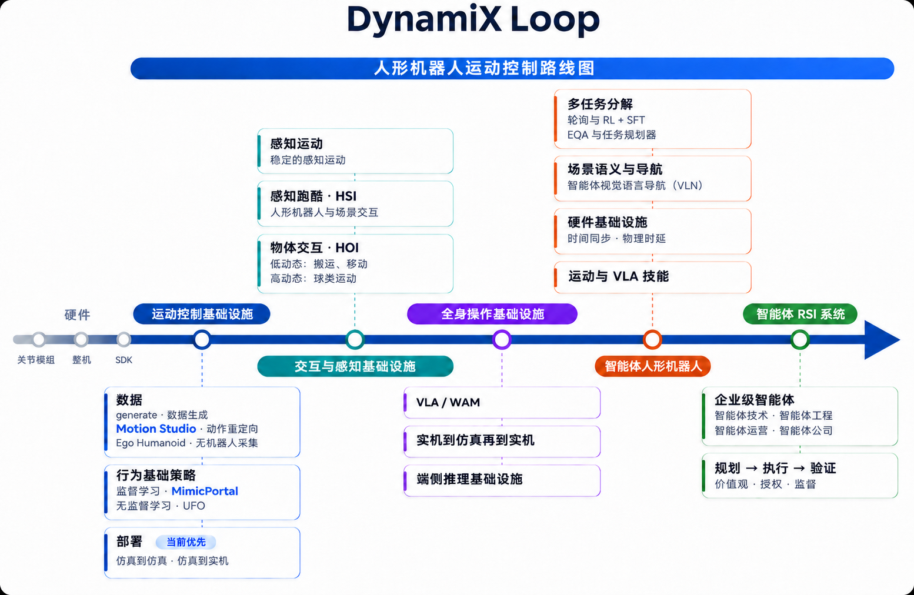

# DynamiX Loop

 

[项目网站 · English / 简体中文](https://dynamicx-loop.github.io/dynamix_loop_nexus/)

面向 Lumo 的人形机器人控制技术栈，涵盖运动数据、可复用控制策略、感知、物体交互、全身操作和智能体技能。

[GitHub 组织](https://github.com/Dynamicx-Loop)

运动控制技术栈涵盖运动捕捉与生成、运动重定向、行为基础策略和部署。

## 目录

- [路线图](#路线图)
- [项目](#项目)
- [数据集](#数据集)
  - [运动控制数据集](#运动控制数据集)
  - [操作数据集](#操作数据集)
  - [智能体数据集](#智能体数据集)
- [致谢与参考](#致谢与参考)
- [许可证](#许可证)

## 路线图

[英文路线图](assets/dynamix-loop-roadmap.png) · **简体中文路线图**

**近期重点：**搭建部署基础设施，支持仿真到仿真（sim-to-sim）、仿真到实机（sim-to-real）和实机到仿真（real-to-sim）。路线图展示各项能力之间的递进关系，不设固定日期。

## 项目

**使用中**表示团队正在使用该仓库。其他第三方项目供参考或评估。

| 体系层 | 模块 | 说明 | 仓库 |
|---|---|---|---|
| 知识沉淀 | 知识库 | DynamiX Loop 的人形机器人控制知识库。 | 🚧 **建设中** |
| 运动控制基础设施 | 数据生成 · `generate` | 生成用于策略训练的运动数据。 | [NVIDIA Kimodo](https://github.com/nv-tlabs/kimodo) |
| 运动控制基础设施 | 运动重定向 | **Motion Studio** 是计划采用的主要运动重定向工具，**hhtools** 是当前的备选方案。 | [DynamiX Loop Motion Studio](https://github.com/Dynamicx-Loop/motion-studio) · [hhtools](https://github.com/Roboparty/human-humanoid-tools) |
| 运动控制基础设施 | 行为基础策略 · **MimicPortal** | DynamiX Loop 的运动跟踪策略开发仓库。 | [Dynamicx-Loop/mimicportal](https://github.com/Dynamicx-Loop/mimicportal) · [上游仓库](https://github.com/Roboparty/PartyMimic) |
| 运动控制基础设施 | 无监督学习 · `UFO` | **使用中。** 通过 FB 和 TeCH 学习可复用的人形机器人行为。 | [UFO](https://github.com/Roboparty/UFO) |
| 运动控制基础设施 | 动作扩散 · `PredActor` | 使用扩散模型生成运动与动作的上游参考。 | [参考分支](https://github.com/Roboparty/PredActor) · [MasterYip 上游仓库](https://github.com/MasterYip/PredActor) |
| 运动控制基础设施 | 无机器人采集 · `Ego Humanoid` | 无需机器人即可采集人体运动。 | [DynamiX Loop 路线图](#路线图) |
| 运动控制基础设施 | 部署 · **近期重点** | 将策略迁移到不同仿真器及机器人实机，并利用实机数据改进仿真。**仿真到仿真 · 仿真到实机 · 实机到仿真。** | 团队工作方向，暂无指定仓库 |
| 交互与感知基础设施 | 交互 BFM · `I-BFM` | **使用中。** 学习与物体交互的全身技能。 | [I-BFM](https://github.com/Roboparty/I-BFM-Code) · [部署示例](https://github.com/Roboparty/I-BFM-Code/tree/main/deploy/g1_carry_box_166m) |
| 交互与感知基础设施 | 感知 BFM · `P-BFM` | **使用中。** 学习适应地形的移动与运动跟踪。 | [P-BFM](https://github.com/Roboparty/P-BFM) |
| 全身操作基础设施 | JEPA 世界模型 · `INTACT-JEPA` | 基于动作意图进行预测的世界模型参考。 | [参考分支](https://github.com/Roboparty/INTACT-JEPA) · [浙江大学上游仓库](https://github.com/zju3dv/INTACT-JEPA) |
| 表征学习 | 抗坍塌损失 · `SADL` | 使用供需损失（Supply And Demand Loss）缓解表征坍塌的上游参考。 | [参考分支](https://github.com/Roboparty/SADL) · [浙江大学上游仓库](https://github.com/zju3dv/SADL) |

智能体人形机器人（Agentic Humanoid）和 Agent RSI System 是长期方向，暂未确定实施计划。

## 数据集

本目录汇总运动控制、操作和智能体研究所需的数据集。请从链接指向的来源获取数据并引用相应版本；在使用或再分发前，查阅访问条件和许可条款。团队选用数据集时，应记录版本、用途、重定向配置以及训练集和评估集的划分。

### 运动控制数据集

🏃 <strong>运动控制</strong>：用于运动跟踪策略的人体运动、交互和地形运动数据（15 项）

 

[hhtools 重定向模式](https://github.com/Roboparty/human-humanoid-tools/blob/main/docs/datasets.md)：**mimic** 用于平地运动跟踪，**intermimic** 用于物体交互，**meshmimic** 用于地形运动，**R2R** 用于机器人之间的迁移。“—”表示此处未记录团队用途。

| 数据集 | 内容 | hhtools 模式 | 论文 | 下载 | DynamiX Loop 用途 |
|---|---|---|---|---|---|
| AMASS | 汇总多个光学动作捕捉数据集，采用 SMPL-X 表示。 | mimic | [📄&nbsp;arXiv](https://arxiv.org/abs/1904.03278) | [🌐&nbsp;site](https://amass.is.tue.mpg.de/) | — |
| LAFAN1 | BVH 动捕数据，涵盖移动、舞蹈、跌倒和恢复等动作。 | mimic | [📄&nbsp;arXiv](https://arxiv.org/abs/2102.04942) | [💻&nbsp;GitHub](https://github.com/ubisoft/ubisoft-laforge-animation-dataset) | MimicPortal |
| BONES-SEED (SOMA) | 采用 SOMA 表示的大规模动作捕捉语料库。 | mimic | [📄&nbsp;arXiv](https://arxiv.org/abs/2603.16858) | [🤗&nbsp;HF](https://huggingface.co/datasets/bones-studio/seed) | MimicPortal |
| 100STYLE | 用 Xsens 采集多种风格的步行和跑步动作，以 60 Hz BVH 格式发布。 | mimic | [📄&nbsp;ACM](https://dl.acm.org/doi/10.1145/3522618) | [🌐&nbsp;site](https://www.ianxmason.com/100style/) | MimicPortal |
| HiPHI | 通过光学动捕记录人体全身运动和人与物体交互。 | — | [Noitom Robotics](https://noitomrobotics.com/hiphi-a-large-scale-benchmark-for-high-precision-human-motion-and-object-interaction/) | [Hugging Face](https://huggingface.co/datasets/noitomrobotics/HiPHI) | — |
| MotionDecode | 以 120 Hz 采样的 Unitree G1 运动轨迹。 | R2R | [🌐&nbsp;site](https://chingmudata.github.io/MotionDecode/) | [🤗&nbsp;HF](https://huggingface.co/datasets/CMRobot/MotionDecode) | — |
| Motion-X | 从视频中重建的全身运动。 | mimic | [📄&nbsp;NeurIPS](https://proceedings.neurips.cc/paper_files/paper/2023/file/4f8e27f6036c1d8b4a66b5b3a947dd7b-Paper-Datasets_and_Benchmarks.pdf) | [💻&nbsp;GitHub](https://github.com/IDEA-Research/Motion-X) | — |
| PHUMA | 包含物理约束信息的人形运动数据。 | mimic | [📄&nbsp;arXiv](https://arxiv.org/abs/2510.26236) | [💻&nbsp;GitHub](https://github.com/DAVIAN-Robotics/PHUMA) | — |
| GVHMR | 从单目视频重建人体运动的工具。 | mimic | [📄&nbsp;arXiv](https://arxiv.org/abs/2409.06662) | [💻&nbsp;GitHub](https://github.com/zju3dv/GVHMR) | — |
| OMOMO | 人与物体交互的运动序列。 | intermimic | [📄&nbsp;arXiv](https://arxiv.org/abs/2309.16237) | [🤗&nbsp;HF](https://huggingface.co/datasets/YaojieShen/hhtools_omomo) | — |
| OmniContact | 以 90 Hz 光学动捕记录的人与物体交互序列。 | intermimic | [📄&nbsp;arXiv](https://arxiv.org/abs/2606.26201) | [🤗&nbsp;HF](https://huggingface.co/datasets/lightcone02/OmniContact-Dataset) | — |
| holosoma | 用于感知式移动和跑酷的运动与地形参考。 | meshmimic | [📄&nbsp;arXiv](https://arxiv.org/abs/2509.26633) | [💻&nbsp;GitHub](https://github.com/amazon-far/holosoma) | — |
| PARC MS | 与地形对齐的障碍跨越和跑酷动作。 | meshmimic | [📄&nbsp;arXiv](https://arxiv.org/abs/2505.04002) | [🤗&nbsp;HF](https://huggingface.co/datasets/YaojieShen/hhtools_parc_ms) | — |
| Parkour Mocap | 143 段跨越障碍的动作，包含撑越、坡道、平衡木和空翻，采用 120 Hz 光学动捕。 | meshmimic | — | [🤗&nbsp;HF](https://huggingface.co/datasets/YaojieShen/hhtools_parkour_mocap) | — |
| any4hdmi collection | 已转换为可用于策略训练格式的运动数据集合集。 | — | — | [🤗&nbsp;HF](https://huggingface.co/collections/elijahgalahad/any4hdmi) | — |

### 操作数据集

🤲 <strong>操作</strong>：机器人遥操作、人形机器人、人体第一视角和仿真数据（19 项）

 

| 类别 | 数据集 | 内容 | 论文 | 下载 |
|---|---|---|---|---|
| 🦾 跨本体机器人 | Open X-Embodiment | 覆盖 22 种机器人本体，包含逾 100 万条实机轨迹。 | [📄&nbsp;arXiv](https://arxiv.org/abs/2310.08864) | [🌐&nbsp;site](https://robotics-transformer-x.github.io/) |
|  | DROID | 在多种真实环境中采集的 7.6 万条 Franka 操作轨迹。 | [📄&nbsp;arXiv](https://arxiv.org/abs/2403.12945) | [🌐&nbsp;site](https://droid-dataset.github.io/) |
|  | BridgeData V2 | 在不同环境中采集的 WidowX 操作示范。 | [📄&nbsp;arXiv](https://arxiv.org/abs/2308.12952) | [🌐&nbsp;site](https://rail-berkeley.github.io/bridgedata/) |
|  | AgiBot World | 面向双臂操作的大规模实机数据。 | [📄&nbsp;arXiv](https://arxiv.org/abs/2503.06669) | [🤗&nbsp;HF](https://huggingface.co/datasets/agibot-world/AgiBotWorld-Beta) |
|  | RoboMIND | 涵盖人形机器人在内的多种机器人本体的遥操作轨迹。 | [📄&nbsp;arXiv](https://arxiv.org/abs/2412.13877) | [🌐&nbsp;site](https://x-humanoid-robomind.github.io/) |
|  | Galaxea Open-World | 在家庭及工作空间采集的移动双臂操作数据。 | [📄&nbsp;arXiv](https://arxiv.org/abs/2509.00576) | [🤗&nbsp;HF](https://huggingface.co/datasets/OpenGalaxea/Galaxea-Open-World-Dataset) |
| 🤖 人形机器人 | Humanoid Everyday | 开放环境下的人形机器人操作数据。 | [📄&nbsp;arXiv](https://arxiv.org/abs/2510.08807) | [🌐&nbsp;site](https://humanoideveryday.github.io/) |
|  | GR00T X-Embodiment Sim | 用于 GR00T N1 的机械臂与人形机器人仿真轨迹。 | [📄&nbsp;arXiv](https://arxiv.org/abs/2503.14734) | [🤗&nbsp;HF](https://huggingface.co/datasets/nvidia/PhysicalAI-Robotics-GR00T-X-Embodiment-Sim) |
|  | Unitree open datasets | 采用 LeRobot 格式的 G1 灵巧手遥操作数据。 | — | [🤗&nbsp;HF](https://huggingface.co/unitreerobotics) |
| 👐 人体第一视角与手物交互 | Ego4D | 超过 3,000 小时的第一视角视频。 | [📄&nbsp;arXiv](https://arxiv.org/abs/2110.07058) | [🌐&nbsp;site](https://ego4d-data.org/) |
|  | EgoDex | 包含三维手部跟踪的第一视角灵巧操作任务。 | [📄&nbsp;arXiv](https://arxiv.org/abs/2505.11709) | [💻&nbsp;GitHub](https://github.com/apple/ml-egodex) |
|  | HOT3D | 第一视角多视点下的手与物体三维跟踪数据。 | [📄&nbsp;arXiv](https://arxiv.org/abs/2411.19167) | [🌐&nbsp;site](https://facebookresearch.github.io/hot3d/) |
|  | ARCTIC | 双手与关节物体的灵巧交互。 | [📄&nbsp;arXiv](https://arxiv.org/abs/2204.13662) | [🌐&nbsp;site](https://arctic.is.tue.mpg.de/) |
|  | OakInk2 | 复杂活动中的双手物体交互。 | [📄&nbsp;arXiv](https://arxiv.org/abs/2403.19417) | [🌐&nbsp;site](https://oakink.net/v2/) |
|  | DexYCB | 使用 YCB 物体采集的手部抓取数据。 | [📄&nbsp;arXiv](https://arxiv.org/abs/2104.04631) | [🌐&nbsp;site](https://dex-ycb.github.io/) |
|  | GigaHands | 大规模双手活动标注记录。 | [📄&nbsp;arXiv](https://arxiv.org/abs/2412.04244) | [🌐&nbsp;site](https://ivl.cs.brown.edu/research/gigahands.html) |
| 🧪 仿真基准 | LIBERO | 用于机器人操作终身学习的仿真套件。 | [📄&nbsp;arXiv](https://arxiv.org/abs/2306.03310) | [🌐&nbsp;site](https://libero-project.github.io/) |
|  | RoboCasa | 面向机器人家务操作的仿真环境。 | [📄&nbsp;arXiv](https://arxiv.org/abs/2406.02523) | [🌐&nbsp;site](https://robocasa.ai/) |
|  | BEHAVIOR-1K | 覆盖上千项日常活动的仿真套件。 | [📄&nbsp;arXiv](https://arxiv.org/abs/2403.09227) | [🌐&nbsp;site](https://behavior.stanford.edu/) |

部分数据集采用 [LeRobot](https://huggingface.co/lerobot) 通用训练数据格式，具体以各数据源的说明为准。

### 智能体数据集

🧠 <strong>智能体</strong>：任务规划、具身问答、导航和三维场景理解（14 项）

 

以下分类对应路线图中的智能体人形机器人分支。

| 路线图方向 | 数据集 | 内容 | 论文 | 下载 |
|---|---|---|---|---|
| 📋 任务规划与多任务分解 | ALFRED | 由语言指令驱动的仿真家务任务。 | [📄&nbsp;arXiv](https://arxiv.org/abs/1912.01734) | [🌐&nbsp;site](https://askforalfred.com/) |
|  | EgoPlan-Bench | 面向多模态语言模型的第一视角规划基准。 | [📄&nbsp;arXiv](https://arxiv.org/abs/2312.06722) | [💻&nbsp;GitHub](https://github.com/ChenYi99/EgoPlan) |
|  | RoboVQA | 融合机器人观测与语言的长时程推理基准。 | [📄&nbsp;arXiv](https://arxiv.org/abs/2311.00899) | [🌐&nbsp;site](https://robovqa.github.io/) |
|  | ShareRobot (RoboBrain) | 带有可供性和轨迹标注的机器人规划数据。 | [📄&nbsp;arXiv](https://arxiv.org/abs/2502.21257) | [🌐&nbsp;site](https://superrobobrain.github.io/) |
|  | EmbodiedBench | 评估智能体如何利用视觉与语言在具身环境中行动。 | [📄&nbsp;arXiv](https://arxiv.org/abs/2502.09560) | [🌐&nbsp;site](https://embodiedbench.github.io/) |
| ❓ 具身问答（EQA） | EQA | 需要在三维仿真住宅中进行具身探索的问答任务。 | [📄&nbsp;arXiv](https://arxiv.org/abs/1711.11543) | [🌐&nbsp;site](https://embodiedqa.org/) |
|  | OpenEQA | 利用情景记忆或主动探索回答开放词汇问题。 | CVPR 2024 | [🌐&nbsp;site](https://open-eqa.github.io/) |
| 🧭 场景语义与导航（VLN） | R2R | 在真实建筑的扫描场景中执行语言引导导航。 | [📄&nbsp;arXiv](https://arxiv.org/abs/1711.07280) | [🌐&nbsp;site](https://bringmeaspoon.org/) |
|  | RxR | 具备密集对齐标注的多语言导航指令。 | [📄&nbsp;arXiv](https://arxiv.org/abs/2010.07954) | [💻&nbsp;GitHub](https://github.com/google-research-datasets/RxR) |
|  | VLN-CE | 连续仿真环境中的视觉与语言导航。 | [📄&nbsp;arXiv](https://arxiv.org/abs/2004.02857) | [🌐&nbsp;site](https://jacobkrantz.github.io/vlnce/) |
|  | HM3D | 用于具身研究的约一千个大型三维环境。 | [📄&nbsp;arXiv](https://arxiv.org/abs/2109.08238) | [🌐&nbsp;site](https://aihabitat.org/datasets/hm3d/) |
| 🏠 三维场景理解 | ScanNet | 带标注的室内空间三维重建。 | [📄&nbsp;arXiv](https://arxiv.org/abs/1702.04405) | [🌐&nbsp;site](http://www.scan-net.org/) |
|  | ScanQA | 基于三维场景的问答。 | [📄&nbsp;arXiv](https://arxiv.org/abs/2112.10482) | [💻&nbsp;GitHub](https://github.com/ATR-DBI/ScanQA) |
|  | SQA3D | 结合智能体在三维场景中所处情境的问答。 | [📄&nbsp;arXiv](https://arxiv.org/abs/2210.07474) | [🌐&nbsp;site](https://sqa3d.github.io/) |

**内部数据与实机日志：**将运动数据和机器人描述的版本、坐标系及时间基准约定、标定输入和留作回归测试的运行记录与外部数据集分开管理。

## 致谢与参考

感谢 **RoboParty Lab**。[Party OS](https://github.com/Roboparty/Party_OS) 为本项目提供了路线图结构和[视觉参考](https://github.com/Roboparty/Party_OS/blob/main/assets/party-os-roadmap-en.png)，也是项目和数据集目录的起点。参见[原始路线图](https://github.com/Roboparty/Party_OS#roadmap)及其[绘图脚本](https://github.com/Roboparty/Party_OS/blob/main/scripts/build_roadmap.py)。

- **运动控制：**[MimicPortal](https://github.com/Dynamicx-Loop/mimicportal) 以 [PartyMimic](https://github.com/Roboparty/PartyMimic) 为起点，同时参考了 [MimicLite](https://github.com/Roboparty/MimicLite)、[UFO](https://github.com/Roboparty/UFO)、[hhtools](https://github.com/Roboparty/human-humanoid-tools) 和 [PredActor](https://github.com/MasterYip/PredActor)。
- **交互与世界模型：**[I-BFM](https://github.com/Roboparty/I-BFM-Code)、[P-BFM](https://github.com/Roboparty/P-BFM)、[INTACT-JEPA](https://github.com/zju3dv/INTACT-JEPA) 和 [SADL](https://github.com/zju3dv/SADL) 为技术栈提供参考。项目表区分了 RoboParty 的分支与原始上游仓库。
- **数据集：**感谢目录所链接的原作者和维护者。请遵循各版本的引用要求及使用条款。关于对 Party OS 的改编，详见[第三方声明](THIRD_PARTY_NOTICES.md)。

## 许可证

此处未对 DynamiX Loop 的独立材料声明统一许可证。源自 Party OS 的材料请参见[第三方声明](THIRD_PARTY_NOTICES.md)和[上游 GPL-3.0 许可证原文](licenses/Party-OS-GPL-3.0.txt)。上游 [Party OS 仓库](https://github.com/Roboparty/Party_OS/blob/main/LICENSE)采用 GPL-3.0；各项目、机器人资产、数据集及模型权重分别适用各自条款。发布或复用前，请核实每项材料及其分发要求。
